# Salish Sea Surf Report
**Updated:** 2026-10-28 01:44 PDT

---

## Swell Forecast (WAVEWATCH III)

NOAA's GFS-Wave (WAVEWATCH III) forecast at the Neah Bay buoy. Each panel shows
the swell partitions as arrows pointing the way the waves travel; length is height
and colour is period.

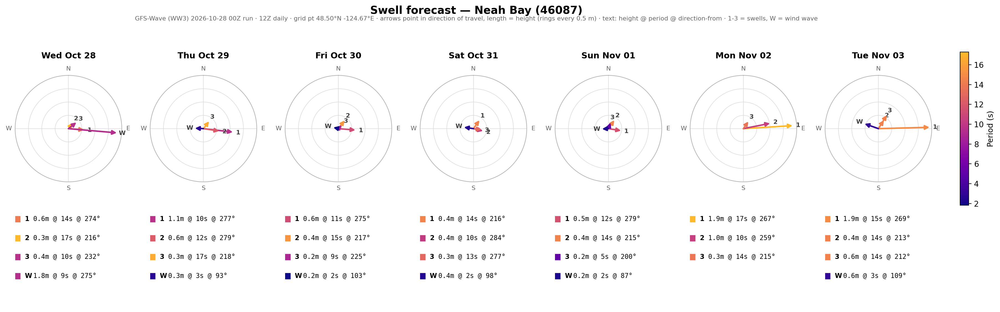

<strong>Hourly forecast, next 48 hours</strong>

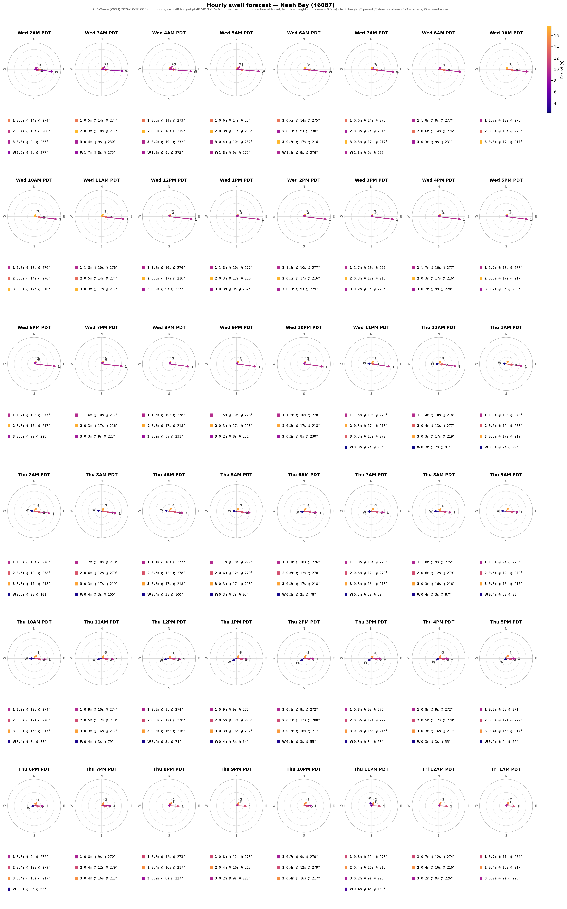

---

## Ray Tracing

### Across the Pacific
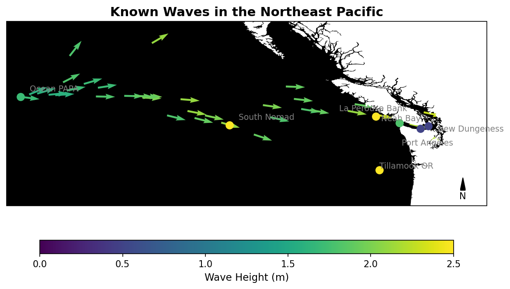

1,600 km off the coast, the Ocean Papa buoy collects wave data.
Using this information, we can infer the trajectory of waves as they travel across the Pacific.
This map uses spherical trigonometry to calculate the azimuth and great-circle path of each wave.
It does not yet include the Coriolis effect — coming soon.

### Strait of Juan de Fuca
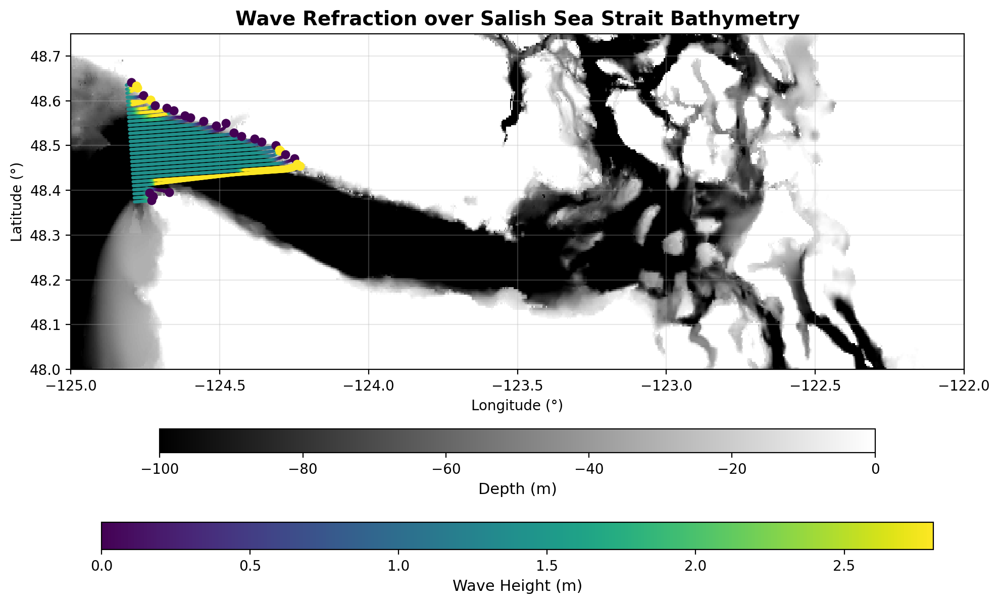

At the entrance of the Salish Sea, the Neah Bay buoy provides us basic wave data.
No other surf models currently incorporate how these waves refract across the Strait.
This ray-tracing diagram illustrates how the coastline bends and redirects incoming wave energy.
A simple algorithm currently predicts wave height by holding energy flux constant.

### Islands Region
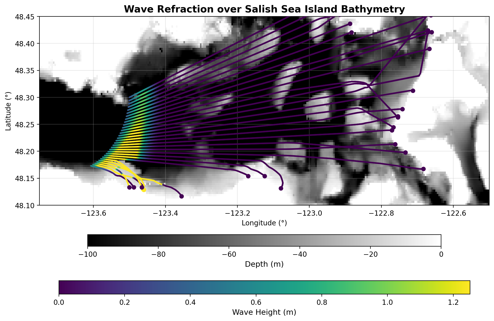

The rays linearly interpolate between the Port Angeles Buoy and the New Dungeness Buoy.
Waves pass over many underwater features but only experience friction and thus
refraction when the depth is less than half the wavelength.

---

## Spectral Model (Parabolic Mild-Slope)

A directionally spread sea state from the Neah Bay buoy is marched shoreward across
10 m bathymetry, capturing refraction, shoaling, diffraction and depth-limited breaking.
The right panel shows the Iribarren number along the shore: whether waves there
spill, plunge or surge, from the local seabed slope and the modelled wave height.

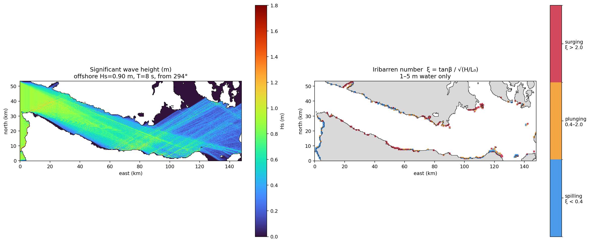

---

## Finite-Difference Model (Airy Waves)

_Not updated this run (skipped: bathymetry grid not found: the_dump_10m.npy, fort_ebey.npy (build it with python -m salish.processing.bathymetry)); any figures below are from an earlier run._

Time-stepped linear wave simulations on 10-30 m bathymetry grids.

### Warmhouse
Olympic Peninsula Headlands

_No output yet._

_No 3D view yet._

### Fort Ebey
Whidbey Island

_No output yet._

_No 3D view yet._

---

# Wave Reports

---

## Ocean Papa Wave Report
Distance: 1642 km to Fort Ebey

- **Wave height:** 5.6 ft
- **Dominant period:** 13 s
- **Wave energy:** 958 kJ/m of crest
- **Waves travelling toward:** 97°
- **Alert status:** normal (waves are 1.7 m, under 5.0 m)

A meter of wave crest has the kinetic energy of a Prius traveling
**2.7 mph.**

<strong>Click to show Ocean Papa plots</strong>

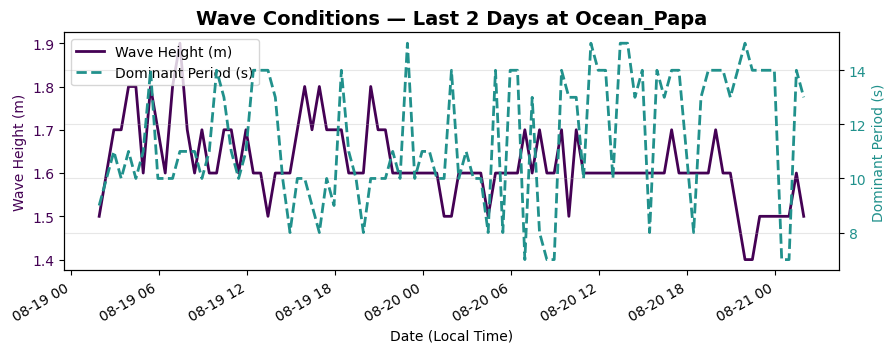  

- [Station Page →](https://www.ndbc.noaa.gov/station_page.php?station=46246)

---

## Neah Bay Wave Report
Distance: 146 km to Fort Ebey

- **Wave height:** 5.9 ft
- **Dominant period:** 10.0 s
- **Wave energy:** 636 kJ/m of crest
- **Waves travelling toward:** 83°
- **Wind:** 5.0 m/s from 260.0°
- **Alert status:** normal (waves travelling 83° are outside the 97-112° window)

A meter of wave crest has the kinetic energy of a Prius traveling
**2.2 mph.**

<strong>Click to show Neah Bay plots</strong>

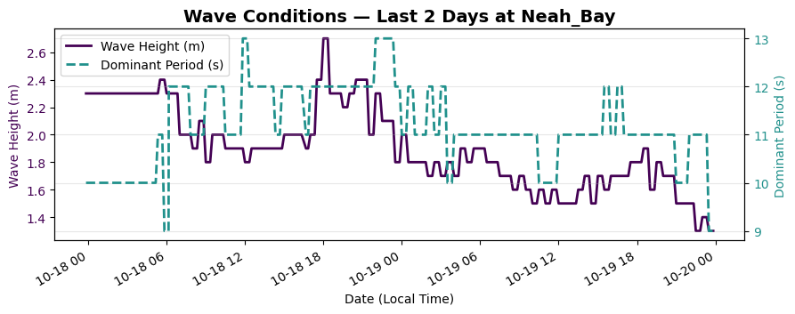  
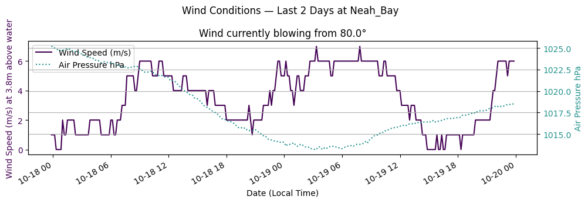  
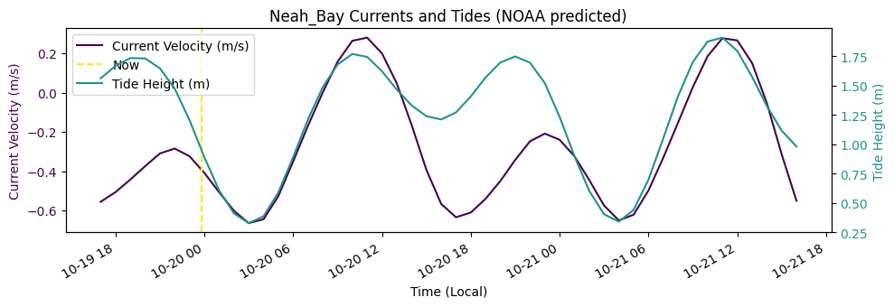  

- [Station Page →](https://www.ndbc.noaa.gov/station_page.php?station=46087)

---

## Port Angeles Wave Report
Distance: 41 km to Fort Ebey

- **Wave height:** 1.6 ft
- **Dominant period:** 10.0 s
- **Wave energy:** 49 kJ/m of crest
- **Waves travelling toward:** 115°
- **Alert status:** normal (waves are 0.5 m, under 1.2 m)

A meter of wave crest has the kinetic energy of a Prius traveling
**0.6 mph.**

<strong>Click to show Port Angeles plots</strong>

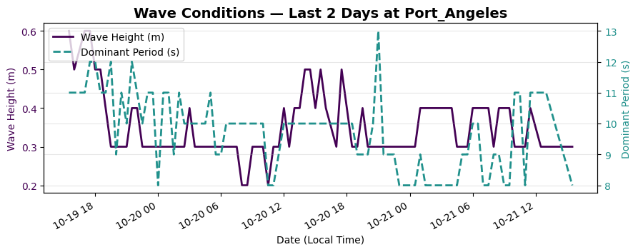  

- [Station Page →](https://www.ndbc.noaa.gov/station_page.php?station=46267)

---

## New Dungeness Wave Report
Distance: 29 km to Fort Ebey

- **Wave height:** 1.6 ft
- **Dominant period:** 8.0 s
- **Wave energy:** 31 kJ/m of crest
- **Waves travelling toward:** 81°
- **Wind:** 5.0 m/s from 230.0°
- **Alert status:** normal (waves are 0.5 m, under 1.0 m)

A meter of wave crest has the kinetic energy of a Prius traveling
**0.5 mph.**

<strong>Click to show New Dungeness plots</strong>

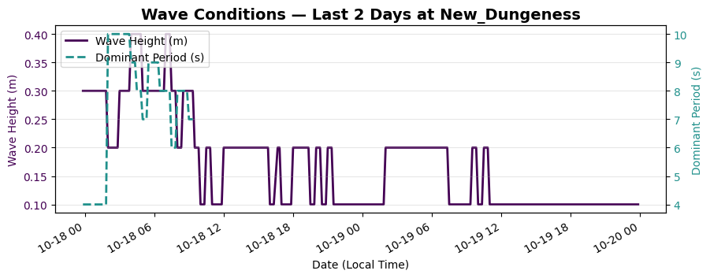  
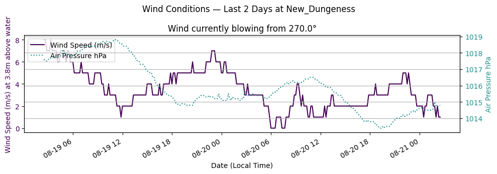  
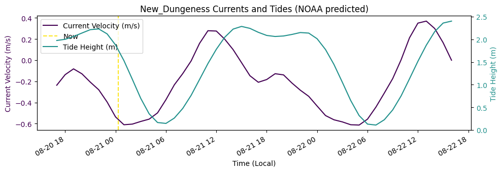  

- [Station Page →](https://www.ndbc.noaa.gov/station_page.php?station=46088)

---

*Report auto-generated from live NOAA buoy data and wave models.*
